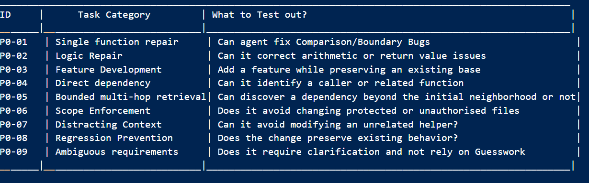

### Phase 0: Mock Repository Evaluation Specification
- What is it: An evaluation-design phase.

- Purpose: To establish a compact, deterministic evaluation contract befotre expanding the guardrails, graph retrieval, synthetic data generation or model training.

- Status: Proposed Specifications ; Implementation and Measurements Pending.

#### Objective
To build a Python mock repository and set a repair tasks that establishes whether the agent can do the following tasks properly:
  i) To Repair a clearly identified single-function defect or issue.
 ii) To understand and abide to explicit developer scope and protected-file constraints.
 iii) To retrieve a small dependency neighborhood when the target function alone isn't sufficient.
 iv) To avoid unrelated patches and edits as well as resist misleading context.
  v) To be able to handle ambiguous requets by asking for clarification from the developer rather than hallucinating or inventing requirements.
 vi) To use test failures as evidence and recover from bad attempts.
 vii) Return structured, reproducible outcomes, that can later support reward and preference-data generation.

#### Initial Benchmark Design


Each benchmark task-case will be recorded in the following format:
{
  "task_id": "P0-01",
  "category": "single_function_repair",
  "base_revision": "recorded_git_commit",
  "issue": "Task description visible to the agent",
  "target_hint": "Optional initial file or function",
  "protected_paths": ["tests/"],
  "test_command": "python -m pytest",
  "acceptance_checks": ["check_id_1"],
  "expected_behavior": "Evaluator-only expected behavior"
}

#### Scope, Goals and Non-Goals
(I) In Scope
   - Python Only
   - A small, locally generated mock repository
   - Single-function repair as the default unit of work
   - A small number of multi-file and two-hop dependency cases.
   - A simple baseline agent/policy and deterministic evaluation harness
   - Explicit tests, protected paths, expected outcomes and repeatable starting states.
   - Standard engineering metrics and later comparison with the official competition evaluation

(II) Out of Scope for the First Iteration alone
   - Full repository Graph Based (AST, DFG) and Git DAG indexing
   - A large scale load testing
   - A claim of production-grade virtually secure sandboxing
   - Multi-language support
   - Training or Reward Optimization before the labels and evaluation contract are reliable
   - Using the same examples for both training and final held-out evaluation

#### Mock Repository Design (Initial)
mock_python_repo/
├── README.md
├── src/
│   ├── discounts.py
│   ├── pricing.py
│   ├── inventory.py
│   └── formatting.py
├── tests/
│   ├── test_discounts.py
│   ├── test_pricing.py
│   ├── test_inventory.py
│   └── test_formatting.py
├── fixtures/
│   └── task_manifest.json
└── .git/

- This structure is subjected to change as we progress. It is kept deliberately small and comprehensible. 

- Each bug shall have a stable task ID, a clean initial commit, a task description, explicit constraints, a test command, and a known expected outcome

#### Task manifest fields
Each task should record the following:
- `task_id`: A stable unique identifier
- `category`: In-Scope, Dependency, Out-Of-Scope, Misleading Concepts
- `base_revision`: Clean starting revision or deterministic fixture identifier.
- `issue`: User-facing request
- `target_hint`: Optional function or file hint, not necessarily the final answer.
- `protected_paths`: Files the agent must not change.
- `test_command`: Controlled test invocation
- `expected_behavior`: Repair, Reject, Clarify or Expand Context
- `acceptance_checks`: Objective conditions used by the evaluator
- `Notes`: Known limitations and logic.

#### Expected Behavior Contract
For each task, both the Outcome and the Process have to be evaluated

**Outcome**
 - The proposed patch applies to the exact base revision
 - Only authorised paths are modified
 - The code parses
 - Targeted tests meet the task's acceptance criteria
 - Existing regression tests remain Green
 - Final response accurately reports what was tested and what wasn't
 - Protected tests and fixtures aren't modified to 'Hack' to success

**Process** 
 - The agent begins with the supplied target context and expands only when required to do so.
 - Retrieved graph edges or historical entries include provenance (eg: source file and symbol)
 - A failed check is returned as structured feedback.
 - The agent may attempt a bounded correction after feedback.
 - The agent stops after a configured attempt or resource budget constraints.
 - The developer retains final authority to accept or reject the proposed patch.

At the end, the correct final patch is our primary outcome. A well-informed explanation or trace that comes with it is our auxiliary evidence and must NOT compensate for a patch that violates hard constraints.

#### Guardrail and Reward Policy
In our initial approach, we are going for a Two-Layer evaluation policy, encompassing Constraints Success/Faolures and Signals:

**Layer I: Hard Constraints**
Hard constraint failures should produce a rejected outcome and a machine-readable reason. 
A violation cannot be offset by success at another dimension:
- Protected-path or explicit scope violation
- Test modification intended by bypass acceptance checks
- Patch cannot be applied to the evaluated base revision
- Execution exceeds the configured resource limit
- The result can't be tied to the exact patch that was validated. Scalar reward system alone doesn't guarantee rules are enforced.

**Layer II: Graded Signals**

For candidates that don't violate hard constraints, the following metrics are recorded:
- Targeted-test success
- Regression-test success
- Syntax Validity
- Minimality/unrelated-diff size
- Evidence quality for diagnosis and retrieved context
- Number of tool calls and execution attempts
- Context tokens, graph nodes, and historical entries that are retrieved
- Latency and Resource usage
- Whether the agent has recovered after actionable failure feedback

Reward coefficients aren't finalised until the harness produces reliable measurements and representative failures have beenr eviewed. 

#### Baselines and Comparison Plan
Starting with baselines that can be easily reproducible:
 - **Target-Only Baseline:** Model receives the issue and target file/function context, first without the graph expansion.
 - **Graph-guided baseline:** Same model and issue, with bounded-graph retrieval enabled
 - **Graph and Execution-Feedback baseline:** The same retrieval policy along with test/syntax/scope feedback and a bounded repair loop.
 - **Post-training comparison (For Later Stages):** Compare the base model and post-trained Gemma 4 under the same tool, context, task and resource budgets.

Model settings, maxiumum turns, tool availability, token budgets, and test commands are kept fixes across comparisons, wherever possible. 

For our initial phase, Llama 3.2:3b via Ollama acts as a placeholder, which can help debug orchestration and data collection. It will NOT be used to claim Gemma 4 capability or post-training gains.

#### Metrics
The following metrixs are taken into considering:
 - **Task Completion Rate:** Tasks meeting their specified expected behavior
 - **Repair Success Rate:** Repair tasks whose required acceptance tests pass.
 - **Regression Rate:** Candidate patches that break previously passing tests.
 - **Scope Compliance:** Fraction of tasks with no unauthorised changes; report hard violations separately
 - **Patch Applicability Rate:** Candidate patches that apply to the evaluated base revision.
 - **Syntax-validity Rate:** Patches that leave modified Python files syntatically valid.
 - **Clarification/Rejection Quality:** Ambiguous and out-of-scope tasks handled correctly.
 - **Tool Efficiency:** Tool calls and execution attempts per task and per successful repair.
 - **Context Cost:** Prompt tokens, graph nodes/edges, and history items retrieved.
 - **Failure Recovery Rate**: Failed first attempts that become valid repairs after feedback.
 - **Latency and Resource Usage:** Wall-Clock time and Available CPU/GPU/Memory Measurements

#### Relationship to Standard Benchmarks
The mock repository is a fast development and regression suite, not a complete replacement for external benchmark evaluation.

Once the agent is able to complete the local worflow reliably and efficiently, we align a separate evaluation with Official gemma 4 Developer Agent competition harness and its supported model/submission requirements. Any additional benchmark (such as compatabile subset of SWE-Bench) should be selected only after checking task format, environmental cost, licensing/data constraints, and whether it tests the project's actual claims.

#### Phase 0 exit criteria
Phase 0 is ready to close when:
- [ ] The mock repository can be restored deterministically for every
  task.
- [ ] The initial task manifest has stable IDs and objective
  acceptance checks.
- [ ] In-scope, out-of-scope, ambiguous, dependency,
  misleading-context, and regression scenarios are represented.
- [ ] The evaluator checks the exact patch that is applied.
- [ ] Hard constraints are reported separately from graded metrics.
- [ ] A target-only baseline can run end to end and produce structured
  results.
- [ ] Results include failed and incomplete runs, context/tool costs,
  and test outcomes.
- [ ] Training examples and held-out evaluation tasks are separated.
- [ ] Known limitations and any unimplemented checks are documented.
Phase 0 does not require high repair accuracy. Its purpose is to make
failures interpretable and comparisons reproducible before the system
becomes more complex.

#### Phase 0 Implementation Checklist
- [Done!] Define the manifest schema and stable task IDs.
- [Done!] Create the mock Python repository and its initial passing tests.
- [ ] Record a clean starting revision for every benchmark task.
- [ ] Implement evaluator checks for patch applicability, syntax, tests, regressions, and protected paths.
- [ ] Verify that the evaluator checks the exact code that was executed.
- [ ] Produce one machine-readable result for both successful and failed runs.

#### Observations after Running Mock Repository:
```python -m pytest -v
======================== test session starts ========================
platform win32 -- Python 3.11.5, pytest-8.4.2, pluggy-1.7.0 -- E:\Gemma_4_Agent\mock_python_repo\.venv\Scripts\python.exe
cachedir: .pytest_cache
rootdir: E:\Gemma_4_Agent\mock_python_repo
configfile: pytest.ini
testpaths: tests
collected 16 items                                                   

tests/test_discounts.py::test_discount_rate_boundaries[0-0.0] PASSED [  6%]
tests/test_discounts.py::test_discount_rate_boundaries[99.99-0.0] PASSED [ 12%]
tests/test_discounts.py::test_discount_rate_boundaries[100-0.05] PASSED [ 18%]
tests/test_discounts.py::test_discount_rate_boundaries[499.99-0.05] PASSED [ 25%]
tests/test_discounts.py::test_discount_rate_boundaries[500-0.1] PASSED [ 31%]
tests/test_discounts.py::test_discount_rate_boundaries[750-0.1] PASSED [ 37%]
tests/test_discounts.py::test_discounted_total PASSED          [ 43%]
tests/test_formatting.py::test_currency_format PASSED          [ 50%]
tests/test_formatting.py::test_invalid_currency_rejected PASSED [ 56%]
tests/test_inventory.py::test_available_quantity PASSED        [ 62%]
tests/test_inventory.py::test_can_fulfill PASSED               [ 68%]
tests/test_inventory.py::test_negative_inventory_rejected PASSED [ 75%]
tests/test_pricing.py::test_order_price_applies_discount PASSED [ 81%]
tests/test_pricing.py::test_order_price_without_discount PASSED [ 87%]
tests/test_pricing.py::test_negative_inputs_rejected[-1-2] PASSED [ 93%]
tests/test_pricing.py::test_negative_inputs_rejected[1--2] PASSED [100%]

======================== 16 passed in 0.08s =========================
(.venv) PS E:\Gemma_4_Agent\mock_python_repo> python -m pytest .\tests\test_discounts.py -v
======================== test session starts =========================
platform win32 -- Python 3.11.5, pytest-8.4.2, pluggy-1.7.0 -- E:\Gemma_4_Agent\mock_python_repo\.venv\Scripts\python.exe
cachedir: .pytest_cache
rootdir: E:\Gemma_4_Agent\mock_python_repo
configfile: pytest.ini
collected 7 items                                                     

tests/test_discounts.py::test_discount_rate_boundaries[0-0.0] PASSED [ 14%]
tests/test_discounts.py::test_discount_rate_boundaries[99.99-0.0] PASSED [ 28%]
tests/test_discounts.py::test_discount_rate_boundaries[100-0.05] PASSED [ 42%]
tests/test_discounts.py::test_discount_rate_boundaries[499.99-0.05] PASSED [ 57%]
tests/test_discounts.py::test_discount_rate_boundaries[500-0.1] PASSED [ 71%]
tests/test_discounts.py::test_discount_rate_boundaries[750-0.1] PASSED [ 85%]
tests/test_discounts.py::test_discounted_total PASSED           [100%]

========================= 7 passed in 0.10s ==========================
(.venv) PS E:\Gemma_4_Agent\mock_python_repo> Get-Content .\src\discounts.py
### Discount policy for Phase 0 Mock Repo

def discount_rate(subtotal: float)->float:
    if subtotal<100:
        return 0.0 ## 0% below 100
    if subtotal < 500:
        return 0.05 ## 5% from 100 to <500
    return 0.10 ## 10% from 500 and above

def discounted_total(subtotal: float)-> float:
    return round(subtotal * (1.0 -discount_rate(subtotal)), 2)
```

