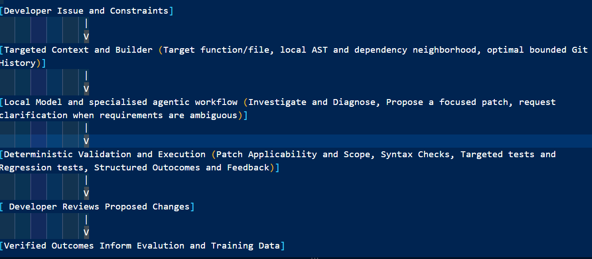

# Gemma-4 Developer Agent: From 'Vibe Coding' to 'Optimized Engineering'

#### Competition and Research Reference:
- The following is our submission for the [Gemma-4 Google Developer Agent Competition] (https://www.kaggle.com/competitions/gemma-4-developer-agent/overview) 
- The following is the first version pre-print currently available giving details about the overall architecture, workflow, and methodology:[Evidence Guided Local Code Generation] (https://zenodo.org/records/23833483)

#### Description
A Research prototype for graph-guided, locally executed code repair with Gemma 4 post-training.

This agent is built to explore whether a compact, targeted context pipeline, specialised agent roles, post-training and deterministic validation can help a locally run model repair Python code efficiently without depending on hosted LLM APIs, and that too as a reliable tool for developers. 

The project is being developed for the Gemma 4 Developer Agent challenge, hosted on Kaggle along with the associated research track. The core research interest is to see how the following components interact and work together: Graph-Guided Context Section, Constraint Patch Generation, Training Data, and Execution Feedback grounded under verifiable outcomes. (Status: Work in Progress, using a local LLM, Llama 3.2:3b through Ollama for local orchestration, as a temporary stand-in while suitable GPU access is arranged.)

#### <u> Introduction </u>
Current market coding agents rely on internet-connected models, which require a powerful commercial infrastructure. This makes advance Software Development and Engineering out of reach for the general audience. This base encompasses the various methologies and approaches used to fine-tune Gemma-4 to not only help developers navigate and optimise their software development workflow and tasks, but also optimize it on existing market hardware. 

This project is aimed at bringing a consolidated architecture that brings a novel approach into making Fine-Tuning, and Optimising easier and effective. It starts off with a working hypothesis that targeted graph-guided context, constrained tool use, deterministic execution feedback, and workflow-focused post-training can complement one another, in order to improve local code-repair reliability under bounded compute and context budgets.

The complementary research paper shall describe further on the architecture, trade-offs, implementation status, evaluation protocol, ablations and negative results as well as the improvements.

#### <u> Goal </u>
Post-train an open source model into a reliable agent for navigating complex coding tasks and codebases, and draft fixes for real software issues, helping in accelerating developer workflow. This can be broken down into the following:

 - **Keep the agent Local-First**: Targeting inference and repair workflows that don't require a hosted LLM API.
 - **Selective Context Usage**: Starting from the target function or file, we then retrieve a bounded dependency neighborhood and relevant Git history only when required.
 - **Constrain Changes**: Validating proposed patches against explicit scope rules and preserve developer controls over whether changes can be accepted.
 - **Execution as Evidence**: Running targeted and regression tests in a controlled workspace/sandbox rather than trusting model assertions about accuracy.
 - **Train for the workflow**: Building verified repair examples and preference data that encourages investigating, appropriate tool usage, and evidence-backed fixes.
 - **Measure the architecture**: Comparison between components and baselines under consistent tasks and resource budgets.

#### Architecture at a Glace
 
                 

#### Initial Approach: Model Distillation/Trajectory Replay Loop:

Instead of traditional RLHF, we can build a **Model Distillation/Trajectory Replay loop**:

- **Teacher Rollouts:** Unconstraining the Base Gemma 4 model, letting it generate multiple varied attempts to fix a dataset of software issues. Tracking its exact CLI Commands, Search Queries, and Patch Generations.

- **Reward Loop:** Applying all the patches in the sandbox. If the patch passes the tests, reward is assigned as +1 and trajectory is saved. If it fails, Reward is assigned as 0 and discarded.

- **Student Distillation (Unsloth LoRA):** Training the LoRA adapters using Unsloth toolkit. The training data is a step-by-step reasoning and chain of thought and retrieval trajectory that shows how the final state (code) is achieved. This is achieved by _teaching_ the model _How_ to navigate, not just how the final diff looks like.

#### Agent Hierarchy Design

Since the goal is to make engineering more structured, moving away from blindly re-writing code snippets (Vibe Coding) can be achieved by making the orchestration enforce a strict chain of thought. Having one massive prompt can be tedious, so we need specialized sub-agents. These can be broken down into the following:

**A) Codebase Mapper (Discovery):**
- **Role:** Finds where the bugs are located

- **Skill Execution:** This agent shouldn't read the whole repository. A custom skill is assigned (such as lightweight regex pipeline or Jaccard Based semantic JSON store) to rapidly index the repo and pull relevant file paths and class structures.

**B) Code Analyzer (Hypothesis Formation):**
- **Role:** Acts as the senior engineer, reading issues and files provided by the Codebase Mapper.

- **Constraint Enforced:** This agent merely makes note, perform RCA and write down a diagnostic markdown report, mentioning which snippets/files require change, and steps to fix them. 

**C) Coder / Patch Executor (Action):**
- **Role:** The coder/dev. It takes the analyzer's hypothesis and outputs a strict unified diff (`.patch` file).

- **Self-Healing Loop:** If the `eval_config.yaml` test fails, the coder agent catches the traceback error, using it to trigger the Mapper to fetch new context, forming a closed loop iterative process that runs until the 12-hour timer nears its limit.

#### Proposed Development LifeCycle

A Four-Phase Development Cycle along with a pre-requisite has been proposed, spanning from setting up local guardrails to LoRA Fine-Tuning:

- **Phase 0 (Mock Repository Evaluation Specification):** Define a small Python repository and a reproducible set of in-scope, out-of-scope, ambiguous and edge-case repair tasks. Establishing ground truth, baseline behavior, hard constraints and metrics before expanding the guardrails or dataset

- **Phase 1 (Local Orchestration and Guardrails Setup):** Deterministic validation scripts for syntaxes, sematics, and training checks are setup in host hardware, returning structured JSON error reports and scalar reward penalties (R ∈ [-1.0, 1.0]). Using a simulated mock agent, it validates the pipeline mechanics.Here, we treat validation outputs as structured evidence, not as a substitute for developer intent.

- **Phase 2 (Synthetic Curriculum Engine):** Starting with a target function or file, we expand by adding relevant callers, callees, imports, and tests and to the neighborhood selectively when evidence requires it. Adding bounded Git history where it provides useful context. Then we validate each synthetic bug with tests that help distinguish the real defects from a superficial mutation

- **Phase 3 (Trajectory Rollouts and Reward Modeling):** This phase is dedicated to formulate agent prompts from synthetic curriculum items, and execute candidate action rollouts by combining reasoning steps, diagnostic reports, and patch diffs. Tool-use trajectories and candidate repairs are generated, along with building preferences and reward labels from reproducible validator and test outcomes. Every example is later audited for task identity, context, patch consistency, evidence and label correctness.

- **Phase 4 (Remote LoRA Distillation and Deployment):** Using Unsloth LoRa fine-tuning on gemma-4 base model. Evaluate the adapters against a baseline, then optimize context budgets, tool policies and runtime packaging for the target environment.

#### Evaluation Principles
 The following are the expected evaluation metrices aimed to report by the end of this development cycle:

   - Repair Success on Held-Out Tasks
   - Regression Rate
   - Scope and Protected-Life compliance
   - Patch applicability and syntax validity
   - Context tokens and Graph nodes retrieved
   - Tool calls and execution attempts per successful repair
   - Recovery after execution feedback
   - Latency and resource usage

Results will make use of the same set of tasks and comparable resource budgets. The mock repository suite is used as an engineering evaluation tool.

#### Safety and Limitations
   - Temporary directories and timeouts do not, by themselves, prevent network access, arbitrary filesystem access, child-process creation or resource exhaustion, hence the current subprocess execution isn't a security boundary.

   - Static Syntax and Scope Checks cannot establish semantic correctness.

   - A structured diagnostic trace is not proof that the diagnosis is correct.

   - Synthetic data can contain invalid mutations, trivial examples, or misleading labels. Curriculum items must be validated before they are used for training.
   
   - Passing targeted tests is useful evidence, although maybe incomplete; regression and scope checks remain necessary.

   - There is No Claim of Gemma 4 performance improvement made until controlled Post-Training Evaluation is complete. 

#### Repository Components
 - `syntax_check.py`: Python Syntax Validation
 - `scope_check.py`: Proposed Patch Scope Validation
 - `pedagogue_check.py`: Structured diagnostic-trace validation
 - `sandbox_repl.py`: Sub-process based Python execution wrapper.
 - `create_cleam_testbed.py`: Starter testbed generation
 - `inject_bugs.py`: AST-Based Synthetic Bug Injection
 - `rollout_trajectories.py`: Prototype trajectory/preference-data generation
 - `local_agent_runner.py` and `local_repair_agent.py`: Local orchestration and repair experiments.
 - `mock_agent.py` (For Validation Harness):Acts as a simulator that runs end-to-end completely to verify that all Guardrail scripts return predictable JSON Schema output and scalar penalties.

#### Getting Started
The setup and commands are being reconciles with current dependency list and script interfaces. Until that pass is complete, the scripts shall be treated as prototype and each script arguments and assumptions shall be inspected before running them.

For prototyping, the local orchestration is using Ollama with Llama 3.2:3b. Gemma 4 model loading, training, adapter evaluation, and final deployment instructions will be documented after those workflows are verified.

#### License